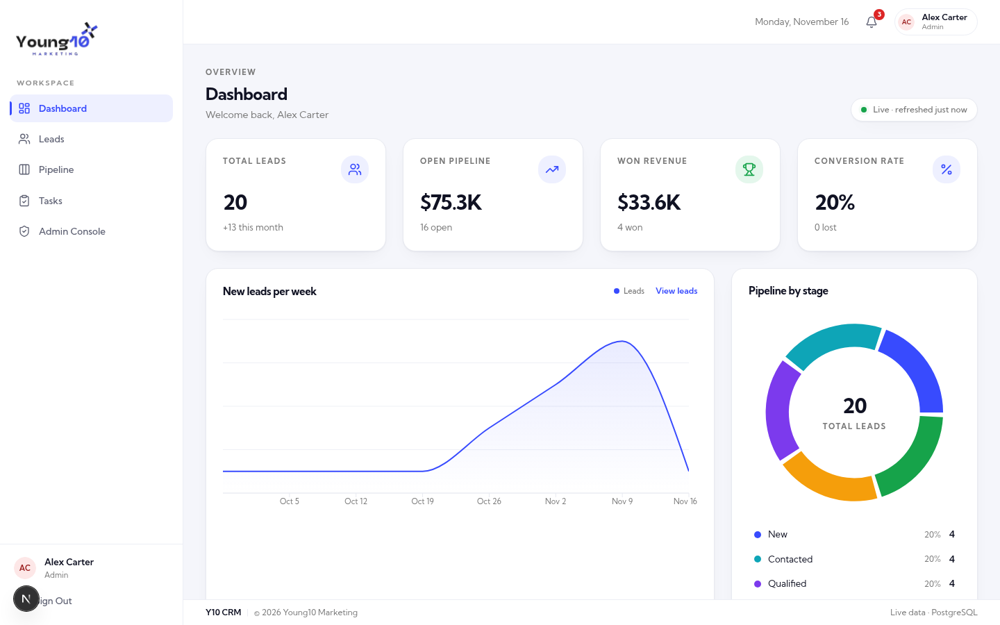
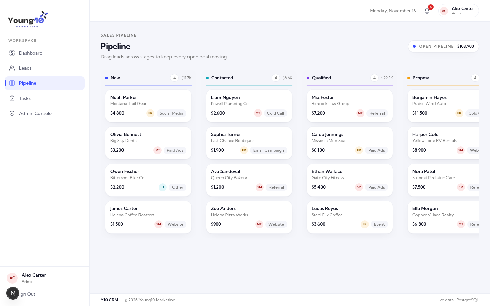
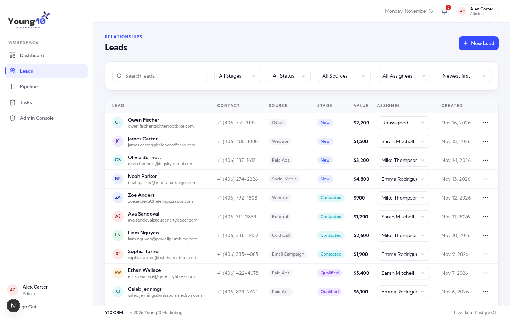
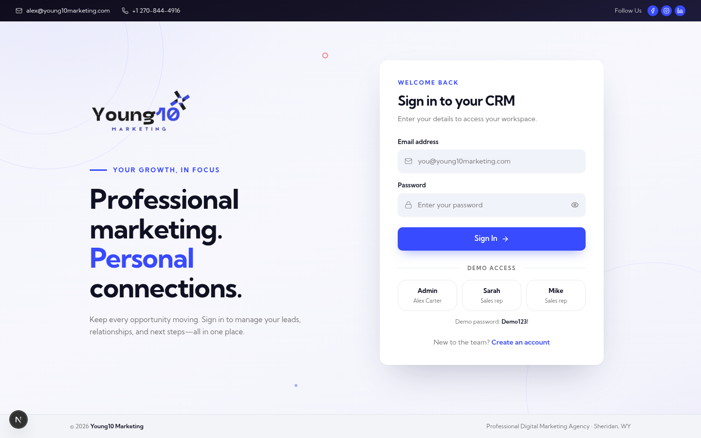
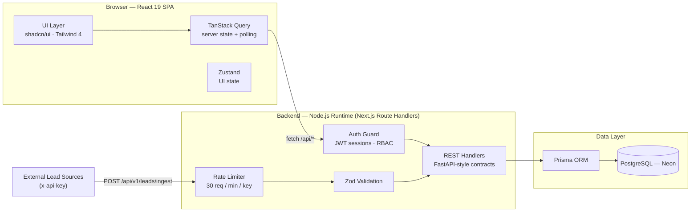
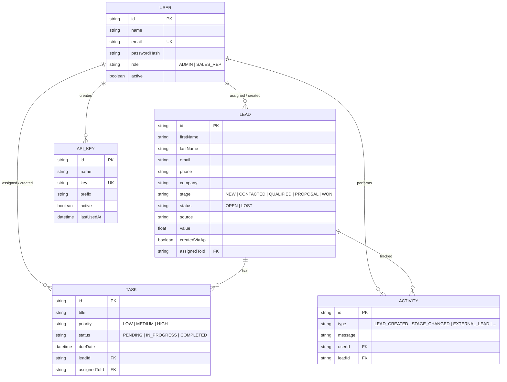

<div align="center">


# Y10 CRM

### Mini CRM &amp; Sales Management SaaS

A production-ready, full-stack Customer Relationship Management platform built for **Young10 Marketing** — lead management, a drag-and-drop sales pipeline, real-time analytics, tasks & follow-ups, role-based access control, and a secure external lead-intake API.

**Engineered on a Node.js REST API layer with PostgreSQL at its core** — every dashboard metric, lead record, and activity event is computed live from the database and streamed to a beautifully reactive frontend.

The design system, wordmark, and color theme are derived directly from [young10marketing.com](https://young10marketing.com/).

**Live App:** [https://faisal-evaluation.vercel.app](https://faisal-evaluation.vercel.app) — production deployment on Vercel.

[](https://faisal-evaluation.vercel.app)
[](https://nextjs.org/)
[](https://react.dev/)
[](https://www.typescriptlang.org/)
[](https://nodejs.org/)
[](https://neon.tech/)
[](https://www.prisma.io/)
[](https://tailwindcss.com/)
[](https://fastapi.tiangolo.com/)
[](./LICENSE)

<br />



</div>

---

## Table of Contents

- [Product Tour](#product-tour)
- [Features](#features)
- [Tech Stack](#tech-stack)
- [Architecture](#architecture)
- [API Documentation](#api-documentation)
- [Getting Started](#getting-started)
- [Role-Based Access Control](#role-based-access-control)
- [Performance](#performance)
- [Security](#security)
- [Deployment](#deployment)
- [Project Structure](#project-structure)
- [License](#license)

---

## Product Tour

| Analytics Dashboard | Sales Pipeline |
| :---: | :---: |
|  |  |
| **Lead Management** | **Sign In** |
|  |  |

---

## Features

- **Authentication & RBAC** — email/password auth with JWT sessions (httpOnly cookies, `jose` + `bcryptjs`). Two roles: `ADMIN` and `SALES_REP`. The first registered account automatically becomes the workspace admin.
- **Lead Management** — full CRUD, live search, stage / status / source / assignee filters, sorting, pagination, admin-only assignment, mark-as-lost, and a complete activity trail.
- **Sales Pipeline** — five-stage kanban (New → Contacted → Qualified → Proposal → Won) with smooth drag-and-drop stage transitions powered by `@dnd-kit`.
- **Real-Time Analytics** — totals, open pipeline value, won revenue, conversion rate, weekly lead trend, stage breakdown, top sources, and a rep leaderboard — computed live from **PostgreSQL** and auto-refreshing every 20 seconds.
- **Tasks & Follow-ups** — priorities, due dates, overdue detection, status workflow, lead linking, and per-lead task creation.
- **Secure Lead Intake API** — `POST /api/v1/leads/ingest` authenticated with `x-api-key`, validated with zod, rate limited at 30 requests/minute per key. Keys are issued and revoked by admins in the Admin Console.
- **Admin Console** — team management (roles, activation) and API key management with usage tracking.
- **Companion Microservices** — a zero-dependency **Node.js** webhook relay and a **Python / FastAPI** lead-scoring engine ship alongside the main app.
- **Brand-Faithful Design** — official Young10 Marketing logo and wordmark, brand blue `#384BFE`, ink `#0F0D1D`, Kumbh Sans typography, and a fully responsive light theme.

---

## Tech Stack

| Layer | Technology |
| --- | --- |
| Frontend | Next.js 16 (App Router) · React 19 · TypeScript 5 |
| Backend | **Node.js** runtime — Next.js Route Handlers exposing a **REST API** designed with **FastAPI-style** conventions (versioned routes, strict request validation, consistent JSON envelope) |
| Database | **PostgreSQL** (Neon serverless) via **Prisma ORM** |
| Auth | JWT sessions — `jose` + `bcryptjs`, httpOnly cookies |
| API Contracts | Zod validation on every mutation |
| Drag & Drop | @dnd-kit |
| Charts | Recharts |
| Server State | TanStack Query (live polling) |
| Client State | Zustand |
| Styling | Tailwind CSS 4 · shadcn/ui · Kumbh Sans |
| Microservices | **Node.js** (`node:http`, zero deps) · **Python / FastAPI** |

---

## Architecture

Y10 CRM is a single deployable **Next.js 16** application. The frontend (React 19) and the backend (**Node.js** REST API layer) live in one type-safe codebase and share `zod` schemas and TypeScript contracts end-to-end. All persistence flows through **Prisma** into **PostgreSQL**.



**Backend conventions** — the REST layer runs on the **Node.js** runtime and follows FastAPI-style design principles: strict typed request validation, predictable resource routing, a uniform JSON response envelope, and dependency-style guards (auth → validation → handler).

**Standalone backend services** (in `services/`) complement the main app:

| Service | Runtime | Path | Purpose |
| --- | --- | --- | --- |
| Lead Relay | **Node.js** (pure `node:http`, zero deps) | `services/lead-relay-service/server.js` | Webhook relay — normalizes provider payloads (Typeform, ads, forms) and forwards them to the CRM intake API with retries + dedupe |
| Lead Scoring | **Python / FastAPI** | `services/lead-scoring-service/main.py` | Scores leads 0-100 (HOT / WARM / COLD) with a factor breakdown so reps know who to call first |

```bash
# Node.js relay  →  node services/lead-relay-service/server.js     (port 4050)
# FastAPI scorer →  uvicorn main:app --port 4060                   (port 4060, run from services/lead-scoring-service/)
```

**Every** API response uses one envelope:

```json
// success
{ "success": true, "data": { ... } }

// failure
{ "success": false, "error": "Invalid email or password" }
```

### Data Model

Five models, seven enums, fully relational — powered by **PostgreSQL**:



---

## API Documentation

Base URL: `/api` — all responses are JSON using the envelope above. Session endpoints authenticate via the `session` httpOnly cookie; the external intake endpoint authenticates via the `x-api-key` header.

### Authentication

| Method | Endpoint | Description | Auth |
| --- | --- | --- | --- |
| `POST` | `/api/auth/register` | Create an account. The **first** registered user becomes `ADMIN` | Public |
| `POST` | `/api/auth/login` | Sign in — sets the JWT session cookie | Public |
| `POST` | `/api/auth/logout` | Clear the session | Session |
| `GET` | `/api/auth/me` | Current user profile (id, name, email, role) | Session |

```bash
# Register — first user becomes workspace admin
curl -X POST http://localhost:3000/api/auth/register \
  -H "Content-Type: application/json" \
  -d '{"name":"Alex Carter","email":"admin@young10marketing.com","password":"Demo123!"}'

# Login
curl -X POST http://localhost:3000/api/auth/login \
  -H "Content-Type: application/json" \
  -c cookies.txt \
  -d '{"email":"admin@young10marketing.com","password":"Demo123!"}'
```

### Leads

| Method | Endpoint | Description | Roles |
| --- | --- | --- | --- |
| `GET` | `/api/leads` | Searchable, filterable, paginated list | Admin: all · Rep: own |
| `POST` | `/api/leads` | Create a lead | Both |
| `GET` | `/api/leads/:id` | Lead detail | Scoped |
| `PATCH` | `/api/leads/:id` | Update fields / stage / notes | Scoped |
| `DELETE` | `/api/leads/:id` | Delete a lead | Admin |
| `POST` | `/api/leads/:id/assign` | Assign a lead to a rep | Admin |

**Query parameters** for `GET /api/leads`:

| Param | Type | Default | Description |
| --- | --- | --- | --- |
| `search` | string | — | Matches name, email, phone, company |
| `stage` | enum | `ALL` | `NEW` · `CONTACTED` · `QUALIFIED` · `PROPOSAL` · `WON` |
| `status` | enum | `ALL` | `OPEN` · `LOST` |
| `source` | enum | `ALL` | `WEBSITE` · `REFERRAL` · `SOCIAL_MEDIA` · `PAID_ADS` · `EMAIL_CAMPAIGN` · `COLD_CALL` · `EVENT` · `OTHER` |
| `assignedToId` | id | `ALL` | Filter by rep |
| `page` | int | `1` | Page number |
| `pageSize` | int | `10` | 1–100 |
| `sort` | string | `createdAt_desc` | e.g. `value_desc`, `firstName_asc` |

```bash
curl "http://localhost:3000/api/leads?search=acme&stage=QUALIFIED&page=1&pageSize=10" -b cookies.txt
```

### Tasks

| Method | Endpoint | Description | Roles |
| --- | --- | --- | --- |
| `GET` | `/api/tasks` | List with `status` (`ALL`·`PENDING`·`IN_PROGRESS`·`COMPLETED`), `mine` (bool), `leadId` filters + overdue counts | Both |
| `POST` | `/api/tasks` | Create a task (optionally linked to a lead) | Both |
| `PATCH` | `/api/tasks/:id` | Update status / priority / due date | Scoped |
| `DELETE` | `/api/tasks/:id` | Delete a task | Scoped |

### Analytics & Activity

| Method | Endpoint | Description | Roles |
| --- | --- | --- | --- |
| `GET` | `/api/analytics` | KPI totals, pipeline value, won revenue, conversion rate, weekly trend, stage breakdown, top sources, rep leaderboard | Admin: workspace · Rep: own |
| `GET` | `/api/activities?limit=10` | Latest workspace activity feed | Both |

### Team Administration

| Method | Endpoint | Description | Roles |
| --- | --- | --- | --- |
| `GET` | `/api/users` | List team members with lead counts | Admin |
| `POST` | `/api/users` | Create a team member | Admin |
| `GET` | `/api/users/:id` | Member detail | Admin |
| `PATCH` | `/api/users/:id` | Change role / activate / deactivate | Admin |

### API Keys

| Method | Endpoint | Description | Roles |
| --- | --- | --- | --- |
| `GET` | `/api/api-keys` | List keys (prefix + usage only) | Admin |
| `POST` | `/api/api-keys` | Issue a key — full secret shown once | Admin |
| `DELETE` | `/api/api-keys/:id` | Revoke a key | Admin |

### External Lead Intake — `POST /api/v1/leads/ingest`

Public HTTPS endpoint for external lead sources (landing pages, ads, forms). Authenticated with an `x-api-key` header, rate limited to **30 requests / minute / key**.

| Field | Type | Required |
| --- | --- | --- |
| `firstName` | string | Yes |
| `lastName` | string | Yes |
| `email` | email | No |
| `phone` | string | No |
| `company` | string | No |
| `jobTitle` | string | No |
| `source` | enum | No (default `WEBSITE`) |
| `value` | number | No (default `0`) |
| `notes` | string | No |

```bash
curl -X POST https://<host>/api/v1/leads/ingest \
  -H "Content-Type: application/json" \
  -H "x-api-key: y10_live_xxxxxxxxxxxx" \
  -d '{
    "firstName": "Jane",
    "lastName": "Doe",
    "email": "jane@acme.com",
    "company": "Acme Inc.",
    "source": "PAID_ADS",
    "value": 4500
  }'
```

```json
// 201 Created
{
  "success": true,
  "data": { "leadId": "cmh...", "message": "Lead captured successfully" }
}
```

Status codes: `201` created · `400` invalid payload · `401` missing/invalid key · `429` rate limited.

---

## Getting Started

### Prerequisites

- **Node.js 18+** (or [Bun](https://bun.sh/))
- A **PostgreSQL** database — [Neon](https://neon.tech/) offers a generous free serverless tier

### Setup

```bash
# 1. install dependencies
bun install            # or: npm install

# 2. configure environment
cp .env.example .env
#    → set DATABASE_URL to your PostgreSQL connection string
#    → set JWT_SECRET to a long random string (openssl rand -base64 48)

# 3. create the schema
bunx prisma db push    # or: npx prisma db push

# 4. seed demo data (20 leads, tasks, activities, team)
DATABASE_URL="<your-url>" bun prisma/seed.ts

# 5. run
bun run dev            # or: npm run dev
```

Open [http://localhost:3000](http://localhost:3000) — the first account you register becomes the workspace admin.

### Demo Accounts (after seeding)

| Role | Email | Password |
| --- | --- | --- |
| Admin | `admin@young10marketing.com` | `Demo123!` |
| Sales Rep | `sarah@young10marketing.com` | `Demo123!` |
| Sales Rep | `mike@young10marketing.com` | `Demo123!` |

The sign-in screen also includes one-click demo buttons that autofill these credentials.

---

## Role-Based Access Control

| Capability | Admin | Sales Rep |
| --- | :---: | :---: |
| View leads | All workspace leads | Only assigned / created |
| Assign leads to reps | Yes | — |
| Delete leads | Yes | — |
| Update lead stage / notes | Yes | Own leads |
| Team management | Yes | — |
| API key management | Yes | — |
| Analytics scope | Workspace-wide | Own book of business |

---

## Performance

- **Parallel analytics aggregation** — the `/api/analytics` endpoint fans out all PostgreSQL aggregations (totals, trend, stage breakdown, sources, leaderboard) concurrently instead of sequentially, cutting dashboard load from seconds to milliseconds.
- **Connection pooling** — PostgreSQL traffic routes through the Neon pooled endpoint, keeping cold starts and connection churn off the critical path.
- **Smart client caching** — TanStack Query dedupes and caches server state with background polling (20s for analytics), so navigation is instant and data stays fresh.
- **Rate limiting at the edge of the API** — token-bucket limiter protects the intake endpoint (30 req/min/key) without touching the database.

## Security

- **Password hashing** — `bcryptjs` with per-user salt; credentials never touch logs or responses.
- **JWT sessions in httpOnly cookies** — signed with `jose`, inaccessible to client JavaScript, `SameSite=Lax` protected.
- **Validation everywhere** — every mutating endpoint parses its payload through a strict zod schema before touching Prisma.
- **Scoped queries by design** — sales reps can only ever select their own leads, tasks, and activities; the database enforces it through filtered Prisma `where` clauses, not frontend hiding.
- **API keys with zero exposure** — keys are hashed at rest, displayed once at issuance, and identified only by prefix in the UI.
- **Parameterized persistence** — Prisma parameterizes every query, eliminating SQL injection by construction.

---

## Deployment

### Vercel — one project, three services (recommended)

> **The production deployment of this repository is live at [https://faisal-evaluation.vercel.app](https://faisal-evaluation.vercel.app).**

The repository ships with a `vercel.json` that defines a **single Vercel project** containing all three components as services, with shared environment variables and one domain:

| Service | Stack | Public path | Cross-service calls |
|---|---|---|---|
| `app` | **Next.js 16** + **Node.js** REST API | `/` (catch-all) | — |
| `lead-relay-service` | **Node.js** (`node:http`, zero deps) | `/relay/*` | → `app` via the `APP_URL` **binding** (forwards leads to `POST /api/v1/leads/ingest`) |
| `lead-scoring-service` | **Python / FastAPI** | `/scoring/*` | none — called externally |

```bash
vercel        # first deploy — imports all three services as one project
vercel dev    # runs every service locally with bindings injected
```

Environment variables to set in the Vercel dashboard (Project → Settings → Environment Variables):

| Variable | Service | Purpose |
|---|---|---|
| `DATABASE_URL` | app | Neon **PostgreSQL** connection string |
| `JWT_SECRET` | app | Signs the httpOnly session cookies |
| `INGEST_API_KEY` | lead-relay-service | CRM API key used to forward captured leads — issue one in the CRM (**Admin → API Keys**) |
| `RELAY_SECRET` | lead-relay-service | Optional shared secret for provider webhooks (`x-relay-secret` header) |

> The `APP_URL` binding is injected by Vercel automatically at runtime — never set it yourself.

After deploying:

- **Provider webhooks** (Typeform, HubSpot, Zapier, ad platforms) should target `https://<your-domain>/relay/webhook` — they may send JSON **or** form-encoded bodies.
- **Scoring requests** go to `https://<your-domain>/scoring/score` and `POST /scoring/score/batch`.

### Self-hosted

Any **Node.js** host works (Railway, Render, Fly.io, a VPS behind Nginx/Caddy) as long as the environment variables below are provided, plus one extra when running the relay on a separate host:

```bash
# app (Next.js + Node.js API)
DATABASE_URL="postgresql://...neon.tech/neondb?sslmode=require"
JWT_SECRET="<long-random-secret>"

# lead-relay-service (points at the app's public origin)
INGEST_URL="https://<your-app-domain>/api/v1/leads/ingest"
INGEST_API_KEY="<key issued in CRM: Admin → API Keys>"

# generate the production client and build
bunx prisma generate && bunx prisma db push
bun run build
```

---

## Project Structure

```
├─ src/
│  ├─ app/
│  │  ├─ page.tsx                 # application shell (auth gate + workspace)
│  │  └─ api/                     # REST API — Node.js route handlers
│  │     ├─ auth/                 # register · login · logout · me
│  │     ├─ leads/                # CRUD · assign  (+ /:id/assign)
│  │     ├─ tasks/                # CRUD
│  │     ├─ analytics/            # aggregated dashboard metrics
│  │     ├─ activities/           # activity feed
│  │     ├─ users/                # team management (admin)
│  │     ├─ api-keys/             # key issuing / revoking (admin)
│  │     └─ v1/leads/ingest/      # external intake (x-api-key)
│  ├─ components/
│  │  ├─ brand/                   # logo mark + wordmark
│  │  ├─ auth/                    # sign-in / sign-up experience
│  │  ├─ layout/                  # sidebar · topbar
│  │  ├─ dashboard/  pipeline/  leads/  tasks/  admin/  shared/
│  │  └─ ui/                      # shadcn/ui primitives
│  ├─ hooks/use-crm.ts            # TanStack Query data layer
│  ├─ store/crm-store.ts          # Zustand UI state
│  ├─ lib/                        # db · auth · api-helpers · validation · rate-limit
│  └─ types/                      # shared TypeScript contracts
├─ services/
│  ├─ lead-relay-service/         # Node.js webhook relay — Vercel service @ /relay/*
│  └─ lead-scoring-service/       # Python / FastAPI lead scoring — Vercel service @ /scoring/*
├─ vercel.json                    # one Vercel project: app + relay + scorer (services, rewrites, binding)
├─ prisma/
│  ├─ schema.prisma               # PostgreSQL schema (5 models, 7 enums)
│  └─ seed.ts                     # demo data seeder
├─ docs/screenshots/              # product screenshots
└─ public/brand/                  # official Young10 Marketing logo assets
```

---

## License

Released under the [MIT License](./LICENSE).

<div align="center">

**Built for [Young10 Marketing](https://young10marketing.com/) — Professional Digital Marketing Agency, Sheridan, WY**

<br />

<a href="https://nextjs.org/">Next.js 16</a> · <a href="https://react.dev/">React 19</a> · <a href="https://www.typescriptlang.org/">TypeScript 5</a> · <a href="https://nodejs.org/">Node.js</a> · <a href="https://www.postgresql.org/">PostgreSQL</a> · <a href="https://neon.tech/">Neon</a> · <a href="https://www.prisma.io/">Prisma</a> · <a href="https://fastapi.tiangolo.com/">FastAPI</a>

</div>
